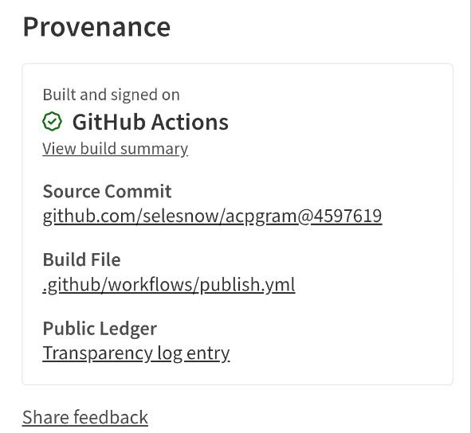

<p>
  <picture>
    <source media="(prefers-color-scheme: dark)" srcset="https://raw.githubusercontent.com/selesnow/acpgram/main/logo/acpgram-logo-light.svg">
    
  </picture>
</p>

# AcpGram

[](https://github.com/selesnow/acpgram/actions/workflows/ci.yml)
[](https://www.npmjs.com/package/acpgram)
[](https://nodejs.org)
[](LICENSE)
[](https://github.com/selesnow/acpgram/actions/workflows/codeql.yml)
[](https://scorecard.dev/viewer/?uri=github.com/selesnow/acpgram)
[](https://www.bestpractices.dev/projects/16722)

**English** · [Русский](README.ru.md) · [Website](https://alexey-seleznev.pro/acpgram/)

A Telegram gateway to AI coding agents — **Gemini CLI**, **Claude Code**, **Antigravity CLI**, **OpenAI Codex** and **OpenCode**. The bot runs the agent as a subprocess on the machine where it is installed and talks to it over the [Agent Client Protocol](https://agentclientprotocol.com) (JSON-RPC over stdin/stdout). You write a task in Telegram; the agent works in the selected project on your server, PC or laptop, and you watch its progress, approve its actions and get the answer right in the chat.

- No runtime npm dependencies — plain Node.js 24 (built-in `node:sqlite`, `fetch`); ESLint is used for development only.
- Windows, Linux and macOS. Tested on Windows Server and Linux (Ubuntu in WSL); macOS uses the same code as Linux.
- Multi-user: the main admin invites teammates and controls what each of them can do.

> The bot's default language is English. It also speaks Russian and Ukrainian: each user gets the language of their Telegram app (`ru`, `uk` or `en`), and `/language` changes it.

## Verified releases

**Published with npm provenance: verify the exact commit behind every release.** Every version of AcpGram is built from the public code in GitHub Actions and signed there; it is never uploaded by hand. The "Provenance" block on the [npm page](https://www.npmjs.com/package/acpgram) links to the exact commit, the workflow file and the public transparency log entry.

<p align="center"></p>

Check it yourself after installing: `npm audit signatures` verifies the registry signature and the provenance of the package. GitHub Release files are also signed with Sigstore (how to verify: [SECURITY.md](SECURITY.md)). The package has no runtime dependencies, the code is scanned by CodeQL, and the project has the OpenSSF Best Practices "passing" badge.

## Features

- **Streaming replies** in a Telegram draft with a stop button: the agent's thoughts, the steps it takes (reading files, running commands, searching, editing) and the elapsed time, then the answer itself.
- **Rich final answer** — headings, lists, tables, code blocks — with a collapsible "work log" of every step and a footer showing the engine, the actual model, reasoning level, tokens, cost (Claude Code and OpenCode) and time.
- **Five engines, one interface** — `/engine` switches between Gemini CLI, Claude Code, Antigravity CLI, Codex and OpenCode; the default engine is set in `.env`.
- **Quick-reply buttons** — when the agent asks you to choose ("Which fix should I apply?"), buttons appear under its question; a tap sends the option to the agent as your message. The bot builds the buttons from the agent's `[[ask: Yes | No]]` marker; raw button tags in the agent's text do not work.
- **See the edit before you allow it** — a permission request for a file edit shows the diff, not only the path.
- **Plan** — if the agent keeps a plan, the draft shows "Plan: 3/7" and its items with check marks.
- **Messages sent while the agent is busy are not lost** — the bot queues the message and sends it as soon as the agent is done; the notice has "Stop and send this now" and "Do not send" buttons.
- **Reply with a quote** — reply to the agent's message with a selected fragment and the agent gets both your text and the fragment ("rewrite this part").
- **Widgets** (Bot API 10.4, enabled with `WIDGETS=1`) — `/model` and `/sessions` open as a widget right in the message: the whole model catalog with groups and vendors is browsed instantly, with no round trips to the bot; project sessions are cards with the start of the request. Widgets are off by default: since November 13, 2026 Telegram does not let ordinary bots send them, and they have not been verified in the app. With `WIDGETS=1` the bot tries the widget and shows the plain button menu if Telegram refuses it or the catalog does not fit the size limit; the same menu is behind the "Plain menu" button under the widget.
- **Model and reasoning level** — `/model` lists the models the agent itself reports (plus `effort` for Claude Code and `thought_level` for Antigravity); the choice is remembered per user and per engine. OpenCode reports hundreds of models (every connected provider), so `/model` first offers groups — "🆓 Free" and the providers — and pages through 20 models at a time; models that cannot call tools (image or music generation) are hidden. Aggregators like OpenRouter (hundreds of models) are split further by model vendor — OpenAI, Anthropic, Qwen… (vendors with 1–2 models go to "Other"). The quickest way is search: `/model sonnet` lists every matching model as buttons; the top of `/model` also has "🕘" buttons with your recently chosen models.
- **Permission requests as buttons** — "Allow", "Allow for this session", "Reject". Options that would persist a rule forever or raise the session above the user's access level are never shown. "Allow for this session" is available in every engine: when the agent has no such option of its own (Claude Code), the bot adds it and keeps the rule for as long as the agent process lives (until `/new`, `/close`, the idle timeout or a bot restart). The button says exactly what will be allowed. File edits are allowed as a whole, commands by program name (allowing `ls` lets every `ls …` through), and for programs with subcommands (`git`, `npm`, `docker` and the like) by program and subcommand: allowing `git status` lets every `git status …` through, but not `git push`. Every part of a compound command must be allowed. Only the exact same command is allowed for shell wrappers (`bash -c`, `powershell`, `cmd /c`, `sudo`), interpreters (`python`, `node`, `Rscript`, `npx` and the like), commands with substitutions, writing to a file (`>`) or variables before the program (`PATH=… git`).
- **Files and images** — send the bot a photo or a file (text, PDF, spreadsheet, etc., up to 20 MB); the caption becomes the request. The file is saved to `<data dir>/uploads/<user id>/` and the agent gets its path and reads it with its own tools. An album of several photos or files is handled as one request. `.zip`, `.tar`, `.tar.gz` and `.tgz` archives are unpacked next to the file (`…_unpacked`, at most 500 files and 100 MB; unsafe paths and links are skipped) and the agent gets the file list; `.7z` and `.rar` stay a plain file; images are also passed as an `image` block when the agent supports it. In the other direction the agent can create a file and send it to the chat: it saves the file to `<data dir>/outbox/<user id>/` (or the project folder) and puts a `[[send:path]]` marker in its reply. The file appears right inside the reply, where the marker was: JPEG and PNG as an image, everything else as a document. If Telegram rejects such a message or the files together exceed 45 MB, they arrive as separate messages after the reply. A marker inside code (backticks or a code block) is ignored. Only files from these two folders are sent, never secrets (`.env`, the bot's database and logs, `.git`). Files are kept for 7 days (`FILES_KEEP_DAYS`).
- **Dialogs mode (topics)** — if topics in private chats are turned on for the bot (@BotFather), each topic of the chat is a separate dialog with the agent, with its own project, engine and history. You can work in several topics at once and come back to a topic later to continue where you left off: the agent session resumes by itself. `/new` creates a new topic, and the agent names it after the first answer (with a short project name in front); General works as a regular dialog, and `/project` there shows the dialogs of the chosen project as buttons that open the topic. A command sent from the chat list rather than from inside a topic (Telegram creates a new topic for such a message by itself) runs in General, and the empty topic is deleted. A topic stays in its own project. Everyone picks the mode with `/topics`: "Dialogs" or "One chat". A teammate runs up to `MAX_AGENTS_PER_USER` agents at once (2), the admin up to `ADMIN_MAX_AGENTS` (4); when there is no room, the user's own oldest idle agent is unloaded, and that dialog continues when the user comes back to it.
- **Language** — the bot talks to each user in their Telegram language (`ru`, `uk` or `en`; any other falls back to `DEFAULT_LANG`, English by default). `/language` changes it and takes priority over the Telegram language. The `acpgram` terminal commands (setup wizard, service, update, help) speak the system language: Russian, Ukrainian, otherwise English; on Windows the system UI language is used, not the regional format.
- **Projects** — `/project` picks the working folder by buttons, by name search or by path (`/project ~/projects/web`), with one-tap recent projects.
- **Sessions** — `/sessions` resumes a previous conversation (in the engine it was created in), even after a restart; `/new` starts fresh; `/close` unloads the agent process.
- **Team access** — invite links and access requests; per-user access levels, engines and model restrictions; `/active` shows who is working and lets the admin end any session.
- **Audit log** — SQLite database with sessions, requests, tool calls, permissions, answers, token usage and cost.

## Supported engines

| Engine | How it is started | Install | Auth |
|---|---|---|---|
| [Gemini CLI](https://github.com/google-gemini/gemini-cli) | `gemini --acp` | `npm i -g @google/gemini-cli` | `GEMINI_API_KEY` or Gemini CLI login |
| [Claude Code](https://www.anthropic.com/claude-code) | `claude-agent-acp` ([ACP bridge](https://www.npmjs.com/package/@agentclientprotocol/claude-agent-acp)) | `npm i -g @agentclientprotocol/claude-agent-acp` | `ANTHROPIC_API_KEY` or Claude Code login |
| [Antigravity CLI](https://antigravity.google/docs/cli/acp/) 1.5+ | `agy acp` | see Antigravity docs | Google sign-in once (`agy acp --login`) or a Gemini API key: `GEMINI_API_KEY` plus `"modelProvider": "gemini"` in `~/.gemini/antigravity-cli/settings.json` |
| [OpenCode](https://opencode.ai) | `opencode acp` | `npm i -g opencode-ai` | provider keys in the bot environment (`ANTHROPIC_API_KEY`, `OPENAI_API_KEY`, `GEMINI_API_KEY`, …) or `opencode auth login`; free OpenCode Zen models need no key (they may use requests for training — keep secrets out) |
| [OpenAI Codex](https://github.com/openai/codex) | `codex-acp` ([ACP bridge](https://www.npmjs.com/package/@agentclientprotocol/codex-acp)) | `npm i -g @agentclientprotocol/codex-acp` (Codex CLI required) | `OPENAI_API_KEY` or `codex login`; on Windows `read-only`/`workspace-write` need a working Codex sandbox |

Only the default engine (`DEFAULT_ENGINE`, Gemini CLI unless set) is required; the others are optional — engines that are not installed are simply not offered.

## Quick start

You need at least one engine from the table above and a Telegram bot token from [@BotFather](https://t.me/BotFather) (Bot API 10.1+ — rich messages and drafts).

### Option 1. Install via npm (requires Node.js 22.13+)

```bash
npm install -g acpgram
```

Then run the setup wizard:
```bash
acpgram setup
```

Settings (`.env`) and SQLite database (`data/bot.db`) are stored in `~/.acpgram` (or `ACPGRAM_HOME`), so updating via `npm install -g acpgram@latest` keeps all settings and history intact.

#### Migrating from install.ps1 (resolving PATH conflict)
The `install.ps1` script adds `%LOCALAPPDATA%\acpgram\bin` to the user `PATH`. If you switch to the npm installation, Windows might still invoke the old script due to `PATH` order.

You do not need to move settings and the database by hand: on the first `acpgram setup` the wizard finds `%LOCALAPPDATA%cpgram` (`~/.local/share/acpgram` on Linux and macOS) and offers to import `.env` and `data/bot.db`. Stop the old service first, otherwise the bot token stays busy and Telegram returns a `Conflict` error.

To switch:
1. Stop and uninstall any previous service:
   ```powershell
   acpgram service uninstall
   ```
2. Check which binary is resolved:
   ```powershell
   Get-Command acpgram
   ```
3. Remove `%LOCALAPPDATA%\acpgram\bin` from user `PATH`:
   ```powershell
   [Environment]::SetEnvironmentVariable("Path", (([Environment]::GetEnvironmentVariable("Path", "User") -split ';') | Where-Object { $_ -notlike '*\acpgram\bin' }) -join ';', "User")
   ```
4. Optionally copy your previous settings and database:
   ```powershell
   New-Item -ItemType Directory -Force "$HOME\.acpgram"
   Copy-Item "$env:LOCALAPPDATA\acpgram\.env" "$HOME\.acpgram\.env"
   if (Test-Path "$env:LOCALAPPDATA\acpgram\data") { Copy-Item -Recurse "$env:LOCALAPPDATA\acpgram\data" "$HOME\.acpgram\" }
   ```
5. Restart your terminal window.

### Option 2. One-line installer

**Windows** (PowerShell):

```powershell
irm https://raw.githubusercontent.com/selesnow/acpgram/main/install.ps1 | iex
```

**Linux / macOS**:

```bash
curl -fsSL https://raw.githubusercontent.com/selesnow/acpgram/main/install.sh | bash
```

The installer downloads the latest [release](https://github.com/selesnow/acpgram/releases) (checksum verified) into `%LOCALAPPDATA%\acpgram` or `~/.local/share/acpgram`, installs a private Node.js 24 if yours is missing or older (official build, checksum verified, no admin rights), adds the `acpgram` command to your PATH and starts the setup wizard. Run it again — or `acpgram update` — to update; your settings and data are kept.

```text
acpgram                    start the bot
acpgram setup              settings wizard
acpgram service install    run as a service (also: restart, stop, status, uninstall)
acpgram update             update to the latest release
```

From source instead (Node.js 24+): `git clone https://github.com/selesnow/acpgram.git && cd acpgram && npm start` — npm scripts mirror the commands: `npm run setup`, `npm run service:install`.

The **setup wizard** (`acpgram setup` / `npm run setup`, safe to re-run — current values are suggested):

1. bot token — checked right away with `getMe`;
2. main admin — just send any message to your bot, the wizard picks up your Telegram ID;
3. projects root — optional (see `PROJECTS_ROOT` below);
4. engines — finds installed Gemini CLI, Claude Code, Antigravity CLI, Codex and OpenCode, stores their full paths (so they are found under a service too), asks for the default engine — OpenCode is suggested first (works right away, no keys, on free models), then Gemini CLI; a re-run suggests the engine already chosen. For OpenCode the wizard asks whether to add provider keys now (Gemini, Anthropic, OpenAI, OpenRouter, Groq, DeepSeek, Mistral) or shows the path to `.env` to add them later. If no engine is installed at all, the wizard offers to install OpenCode right away (`npm i -g opencode-ai` with the same Node installation), so the bot works without a single key;
5. API keys — optional; the token, keys and passwords are typed hidden;
6. writes `.env` (owner-only permissions; the previous one goes to `data/.env.bak`), creates the database and sends you a test message;
7. offers to install the bot as a service.

### Run as a service

Autostart with the system and restart on failure — one command:

| OS | How | Command |
|---|---|---|
| Windows | Windows service via [nssm](https://nssm.cc) (`winget install --id NSSM.NSSM -e`); run the terminal as administrator; you will be offered to run the service under your account (where the agents are signed in) | `npm run service:install` |
| Linux | `systemd --user` (to keep it running without a login session: `sudo loginctl enable-linger $USER`) | `npm run service:install` |
| macOS | LaunchAgent (`launchd`) | `npm run service:install` |

Also: `acpgram service restart` (after an update; a hung service is force-stopped), `acpgram service stop` (stops it without removing: the service starts again after a reboot), `acpgram service status`, `acpgram service uninstall` (npm: `npm run service:status`, `npm run service:uninstall`). Options go after `--` (otherwise npm takes them for itself): `npm run service:install -- --dry-run` prints the commands without running them, `-- --name <name>` sets another service name (default `acpgram`; Windows and Linux), `-- --system` installs a Windows service under LocalSystem without a terminal. Logs: `data/service.log` (Linux: `journalctl --user -u acpgram -f`; Windows PowerShell 5.1: `Get-Content <path>\data\service.log -Tail 30 -Encoding UTF8`, otherwise non-English text looks garbled).

> On Windows the service needs your account's **password**: if you sign in with a Microsoft account, that is the Microsoft account password, not the Windows PIN (with a PIN the service fails to log on — the wizard detects this and asks again). Accounts without a password cannot run services.
>
> The account password is passed to `nssm` as a command-line argument — this is how nssm grants the "Log on as a service" right. It is never printed or stored by the bot and is visible in the process list only to administrators and the same user for the fraction of a second the command runs. Without a terminal the service can only be installed with `--system` (LocalSystem).

### Docker

```bash
cp .env.example .env     # set TELEGRAM_BOT_TOKEN, ALLOWED_USER_ID, engine API keys and uncomment PROJECTS_DIR
docker compose up -d --build
```

In the container the agent sees only the mounted projects folder (`PROJECTS_DIR` → `/projects`). The image ships all five engines: Gemini CLI, Claude Code (`claude-agent-acp` bridge), OpenAI Codex (`codex` + `codex-acp` bridge), Antigravity CLI and OpenCode (`opencode-ai`). To build a lighter image, list only the engines you need in `ENGINES` in `.env` (e.g. `ENGINES=gemini claude`); `DEFAULT_ENGINE` must be one of them.

- Authentication: Gemini - `GEMINI_API_KEY`, Claude Code - `ANTHROPIC_API_KEY`, Codex - `OPENAI_API_KEY`; OpenCode - any of these keys (models of those providers) plus free models without a key (all from `.env`).
- Antigravity CLI: either log in once with your Google account (a link and a code, no browser needed on the server): `docker compose exec -it bot agy acp --login`, or use a Gemini API key: set `GEMINI_API_KEY` in `.env` and add `"modelProvider": "gemini"` to `/home/node/.gemini/antigravity-cli/settings.json` inside the container (it lives in the `gemini-home` volume). The login and settings are kept in the `gemini-home` volume. The build fails if Antigravity cannot be installed or lacks the `acp` subcommand (1.5+) - then drop `agy` from `ENGINES`.
- Volumes: `bot-data`, `gemini-home`, `claude-home`, `codex-home`, `opencode-home` survive container re-creation; `docker compose down -v` removes them.
- An engine that starts but is not authenticated is shown as "login needed" in `/engine`.

## Bot commands

| Command | Who | What |
|---|---|---|
| `/start` | everyone | welcome screen: engine, model, access level, project |
| `/project [name or path]` | everyone | choose the working folder |
| `/engine [gemini, claude, agy, codex, opencode]` | everyone | choose the engine |
| `/model [name]` | everyone | choose the model and reasoning level; with a name — search for a model (`/model sonnet`) |
| `/new` | everyone | new session |
| `/sessions` | everyone | resume a previous session in this project |
| `/stop` | everyone | stop the running request |
| `/close`, `/exit` | everyone | close the session and unload the agent process |
| `/users` | admin | teammates: level, engines, models, end session, revoke access |
| `/active` | admin | active sessions with buttons to end them |
| `/invite` | admin | one-time invite link (24 h) |
| `/usage` | admin | usage: requests, tokens and cost by user for 24 hours, 7 and 30 days |

## Access levels

The main admin is set by `ALLOWED_USER_ID`. Everyone else gets access through an invite link or by asking (the request goes to the admin with buttons).

| Level | Gemini CLI | Claude Code | Antigravity CLI | Codex | OpenCode | Meaning |
|---|---|---|---|---|---|---|
| Read | `plan` | `plan` | `plan` | `read-only` | `plan` | the agent only reads and analyzes |
| Normal | `default` | `default` | `default` | `workspace-write` | `build` | permission requests go to the user |
| Full | `autoEdit` | `bypassPermissions` | `accept-edits` | `agent-full-access` | `build` | edits without confirmation (Claude Code: no confirmations at all) |
| Admin | `autoEdit` | `bypassPermissions` | `accept-edits` | `agent-full-access` | `build` | change with `ACP_MODE`/`GEMINI_ADMIN_MODE`, `CLAUDE_ADMIN_MODE`, `AGY_ADMIN_MODE`, `CODEX_ADMIN_MODE`, `OPENCODE_ADMIN_MODE` |

OpenCode has only two modes (`plan` and `build`); what the agent may do is set by a permission config the bot passes to the agent process in `OPENCODE_CONFIG_CONTENT`: Read — edits and commands are denied (the model does not even see them), page fetches need confirmation; Normal — edits, commands and page fetches need confirmation; Full and admin — everything without confirmation, including folders outside the project.

New teammates get only the default engine; the admin grants other engines and can restrict models per user and per engine. At most `MAX_AGENTS` (3) teammate agents run at once across all engines (the admin is not counted); idle sessions close after `IDLE_MINUTES` (30).

> An agent mode limits what the agent does, but it is **not a sandbox**: the agent runs with the rights of the account the bot runs under. The project folder is where it starts, not a jail. All users share the API keys and quotas. The agent process does not get the bot token, and of the API keys only those of its own engine (Claude Code — `ANTHROPIC_API_KEY`, Codex — `OPENAI_API_KEY`, Gemini CLI and Antigravity — the Google keys, OpenCode — all of them), but the agent can still read files on disk, including the bot's `.env`. Give the "Full" level (Claude Code `bypassPermissions`) deliberately.

## Configuration (`.env`)

| Variable | Required | Description |
|---|---|---|
| `TELEGRAM_BOT_TOKEN` | yes | bot token |
| `ALLOWED_USER_ID` | yes | Telegram ID of the main admin |
| `PROJECTS_ROOT` | no | projects root: projects can be chosen only inside it (team server). Without it any folder on the machine can be chosen, the home folder by default (personal install) |
| `DEFAULT_ENGINE` | no | `gemini` (default), `claude`, `agy`, `codex` or `opencode`; the bot does not start if this engine is not installed |
| `DEFAULT_LANG` | no | bot language when the user's Telegram language is not `ru`, `uk` or `en`: `en` (default), `ru` or `uk`. Each user can change it with `/language` |
| `ACPGRAM_LANG` | no | language of the `acpgram` terminal commands: `ru`, `uk` or `en`. Usually not needed: the language comes from the system (for Docker and CI, where the system has none) |
| `GEMINI_API_KEY` | no | Gemini API key, passed to the agent through the bot's environment |
| `ANTHROPIC_API_KEY` | no | Anthropic API key for Claude Code (API billing instead of a subscription) |
| `OPENROUTER_API_KEY`, `GROQ_API_KEY`, `DEEPSEEK_API_KEY`, `MISTRAL_API_KEY` | no | provider keys for OpenCode: each adds a group of models to `/model` (OpenRouter gives hundreds of models from different providers with one key). Other OpenCode providers work too with their own variables (`XAI_API_KEY`, `FIREWORKS_API_KEY`, etc.) |
| `GEMINI_COMMAND`, `CLAUDE_COMMAND`, `AGY_COMMAND`, `CODEX_COMMAND`, `OPENCODE_COMMAND` | no | full paths to the engines if they are not in `PATH` (typical for services) |
| `ACP_MODE` / `GEMINI_ADMIN_MODE`, `CLAUDE_ADMIN_MODE`, `AGY_ADMIN_MODE`, `CODEX_ADMIN_MODE`, `OPENCODE_ADMIN_MODE` | no | admin session mode per engine |
| `MAX_AGENTS` | no | concurrent teammate agents (3) |
| `MAX_AGENTS_PER_USER` | no | concurrent agents of one teammate across topics (2) |
| `ADMIN_MAX_AGENTS` | no | the same for the admin (4) |
| `IDLE_MINUTES` | no | idle session timeout, minutes (30) |
| `AGENT_START_TIMEOUT` | no | how many seconds to wait for an agent to start; after that the process is stopped (120) |
| `ACPGRAM_DEBUG` | no | `1` — detailed log of what the bot sends to Telegram in `data/debug.log` (up to 5 MB plus one previous file; off by default) |
| `FILES_DIR` | no | folder for received (`uploads`) and outgoing (`outbox`) files (the bot's data folder) |
| `FILES_KEEP_DAYS` | no | how many days to keep those files (7) |
| `WIDGETS` | no | `1` — show `/model` and `/sessions` as widgets when Telegram allows them for the bot (off by default) |
| `ANIMATED_ICONS` | no | `0` — plain emoji instead of animated icons in drafts |

`.env` is never committed. Keep the token and keys out of the code.

## Development

```bash
npm test     # node:test, no dependencies, no Telegram
npm ci && npm run lint   # ESLint (development-only), warnings are errors
```

```
install.ps1       one-line installer for Windows
install.sh        one-line installer for Linux and macOS
src/
  cli.mjs         the acpgram command: start, setup, service, update, version
  cli-i18n.mjs    terminal language (detected from the system) and the texts of the acpgram commands in en, ru, uk
  main.mjs        entry point: loads .env, runs the setup wizard on first start
  setup.mjs       setup wizard
  service.mjs     service: nssm (Windows), systemd --user (Linux), launchd (macOS)
  bot.mjs         message and button routing, access checks
  engines.mjs     engine registry: commands, modes per level, catalogs, usage parsing
  acp.mjs         Agent Client Protocol client (agent subprocess)
  access.mjs      per-user engines and models, model catalogs, applying the choice
  turn.mjs        one request: streaming draft, work log, permissions, final answer
  state.mjs       per-user state: agent process, engine, project, limits, idle reaper
  admin.mjs       invites, access requests, /users, /active
  projects.mjs    project paths (inside the root or anywhere), recent projects, search
  *Ui.mjs         /project, /sessions, /engine, /model screens
  ui.mjs          rendering: drafts, steps, final message, screens
  telegram.mjs    Bot API calls, rich messages, long text splitting, file download and upload
  files.mjs       attachments: names, saving, prompt blocks, [[send:path]] markers, outgoing file checks, cleanup
  archive.mjs     safe unpacking of zip, tar, tar.gz without dependencies
  albums.mjs      collects Telegram albums (shared media_group_id) into one request
  asks.mjs        quick-reply buttons from the agent: the [[ask: …]] marker, button markup, the tapped choice
  diff.mjs        line diff for file-edit permission requests
  incoming.mjs    incoming messages: quotes, unsupported kinds, command typos
  widgets.mjs     HTML widgets: model picker, project sessions, Telegram limits, query parsing
  widgetHost.mjs  sending a widget with a fallback to the plain menu, memory of widget messages
  widgetsUi.mjs   widget queries: model and reasoning level choice, resuming a session
  db.mjs          SQLite: sessions, requests, tool calls, permissions, users, usage
test/             node:test tests and a fake ACP agent
.github/workflows CI (tests on Windows / Linux / macOS) and releases (archives, checksums, installer checks)
```

Releases are built by GitHub Actions on a version tag: tests on all three OSes, `.zip` / `.tar.gz` archives with `SHA256SUMS`, then both installers are verified on Windows, Linux and macOS against the published release. Installers can be tested against a local build with `ACPGRAM_RELEASE_URL=file:///path/to/dist`, `ACPGRAM_VERSION`, `ACPGRAM_NO_SETUP=1`, `ACPGRAM_YES=1`, `ACPGRAM_HOME`.

## License

[MIT](LICENSE) © 2026 Alexey Seleznev
