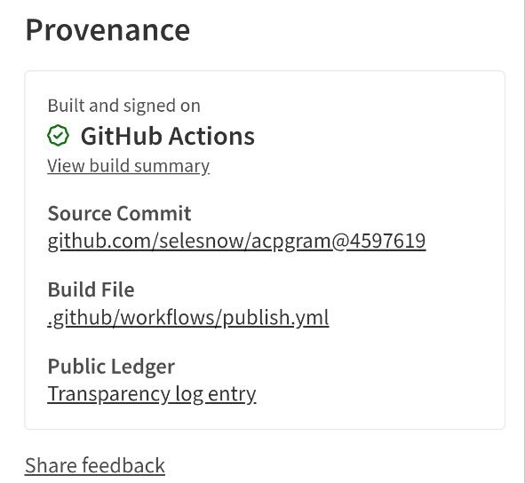

<p>
  <picture>
    <source media="(prefers-color-scheme: dark)" srcset="https://raw.githubusercontent.com/selesnow/acpgram/main/logo/acpgram-logo-light.svg">
    
  </picture>
</p>

# AcpGram

[](https://github.com/selesnow/acpgram/actions/workflows/ci.yml)
[](https://www.npmjs.com/package/acpgram)
[](https://nodejs.org)
[](LICENSE)
[](https://github.com/selesnow/acpgram/actions/workflows/codeql.yml)
[](https://scorecard.dev/viewer/?uri=github.com/selesnow/acpgram)
[](https://www.bestpractices.dev/projects/16722)

[English](README.md) · **Русский** · [Сайт](https://alexey-seleznev.pro/acpgram/)

Telegram-шлюз к AI-агентам разработки **Gemini CLI**, **Claude Code**, **Antigravity CLI**, **OpenAI Codex** и **OpenCode**: бот запускает агента как подпроцесс на той машине, где он установлен, и общается с ним по [Agent Client Protocol](https://agentclientprotocol.com) (JSON-RPC через stdin/stdout). Каждый пользователь выбирает движок сам (`/engine`), движок по умолчанию задаётся в `.env`. Ответы приходят со стримингом, ходом работы агента и кнопками подтверждения действий.

Бот кроссплатформенный (Windows, Linux, macOS): его можно поставить на любой сервер, ПК или ноутбук, заполнив `.env`. Проверено на Windows Server и Linux (Ubuntu в WSL); на macOS используется тот же код, что и на Linux, но отдельно не проверялся.

## Проверяемые релизы

**Публикуется с npm provenance: точный коммит за каждым релизом можно проверить.** Каждая версия AcpGram собирается из публичного кода в GitHub Actions и подписывается там же, а не загружается вручную. Блок «Provenance» на [странице пакета в npm](https://www.npmjs.com/package/acpgram) ведёт на конкретный коммит, файл workflow и запись в публичном журнале прозрачности.

<p align="center"></p>

Проверить самому после установки: `npm audit signatures` проверяет подпись реестра и provenance пакета. Файлы GitHub Release тоже подписаны Sigstore (как проверить — в [SECURITY.md](SECURITY.md)). У пакета нет runtime-зависимостей, код проверяет CodeQL, а у проекта есть бейдж OpenSSF Best Practices «passing».

## Что умеет

- **Стриминг ответа** в черновике сообщения, с кнопкой остановки:
  - пока агент запускается и молчит — родные анимированные точки Telegram («Thinking…»);
  - затем заголовок размышлений агента и ход работы: последние 5 шагов (у выполняющегося — анимированная иконка из набора [AI Actions](https://t.me/addemoji/AIActions)), счётчик остальных и время выполнения;
  - как пошёл ответ — последний шаг и сам ответ.
- **Итоговый ответ** в rich-форматировании: заголовки, списки, таблицы, блоки кода. В конце свёрнутый блок «Ход работы · N шагов» со всеми шагами и подвал: движок, реальная модель, уровень рассуждений, токены, стоимость (Claude Code и OpenCode), проект и время ответа — например `🤖 Claude · claude-haiku-5-5 · 🔢 36.8k ток. · 💲0.0046 · 📁 проект · ⏱ 4 с`. Если Telegram отклонит разметку, ответ уходит обычным текстом.
- **Запросы разрешений** кнопками (режимы `default` и `plan`): «Разрешить», «Разрешить на эту сессию», «Отклонить». Команда показывается блоком кода. Вариант «навсегда» из чата не даётся. «На эту сессию» есть во всех движках: если у агента своего такого варианта нет (Claude Code), его даёт бот — правило живёт, пока работает процесс агента (до `/new`, `/close`, закрытия по простою или перезапуска бота). На кнопке написано, что именно будет разрешено. Правки файлов разрешаются целиком, команды — по имени программы (разрешили `ls` — без вопросов пойдут все `ls …`), а у программ с подкомандами (`git`, `npm`, `docker` и т. п.) — по программе и подкоманде: разрешили `git status` — пойдут все `git status …`, но не `git push`. В составной команде должны быть разрешены все части. Только точно такие же команды разрешаются для оболочек (`bash -c`, `powershell`, `cmd /c`, `sudo`), интерпретаторов (`python`, `node`, `Rscript`, `npx` и т. п.), команд с подстановками, записью в файл (`>`) и переменными перед программой (`PATH=… git`).
- **Кнопки быстрого ответа**: когда агент предлагает выбор («Какой вариант применить?»), под его вопросом появляются кнопки — нажатие отправляет вариант агенту как ваше сообщение. Кнопки строит бот по метке агента `[[ask: Да | Нет]]`; собственные теги кнопок в тексте агента не работают.
- **Правка перед глазами**: в запросе разрешения на правку файла виден дифф — что именно агент изменит, а не только путь.
- **План работы**: если агент ведёт план, в черновике видно «План: 3/7» и пункты с отметками.
- **Сообщение во время работы** не теряется: бот поставит его в очередь и отправит агенту, как только тот закончит; под уведомлением — «Остановить и отправить это» и «Не отправлять».
- **Ответ с цитатой**: ответьте на сообщение агента, выделив фрагмент, — агент получит и ваш текст, и этот фрагмент («перепиши вот это»).
- **Виджеты** (Bot API 10.4, включаются `WIDGETS=1`): `/model` и `/sessions` открываются виджетом прямо в сообщении — весь каталог моделей с группами и вендорами листается мгновенно, без обращений к боту; сессии проекта — карточками с началом запроса. По умолчанию виджеты выключены: с 13 ноября 2026 Telegram не разрешает обычным ботам отправлять их, и в приложении они не проверены. С `WIDGETS=1` бот пробует виджет и сам показывает обычное меню с кнопками, если Telegram его не принял или каталог не поместился в лимит; оно же — по кнопке «Обычное меню» под виджетом.
- **Выбор движка** (`/engine`): Gemini CLI, Claude Code, Antigravity CLI, Codex или OpenCode — из выданных пользователю. Выбор запоминается для каждого пользователя, смена движка начинает новую сессию. Движок по умолчанию — `DEFAULT_ENGINE`; недоступные на сервере движки не предлагаются, а запускающиеся, но не авторизованные (нет входа или ключа API) помечаются «⚠️ нужен вход».
- **Выбор модели и уровня рассуждений** (`/model`): модели текущего движка (список присылает сам агент) и уровень рассуждений у Claude Code (`effort`) и Antigravity CLI (`thought_level`). По умолчанию «Авто» — как у агента. Выбор запоминается для каждого пользователя отдельно по движкам и применяется со следующего запроса, без перезапуска сессии. У OpenCode моделей сотни (все подключённые провайдеры), поэтому сначала выбирается группа — «🆓 Бесплатные» или провайдер, — а модели внутри неё листаются по 20; модели, которые не умеют вызывать инструменты (генерация картинок, музыки), не показываются. У агрегаторов вроде OpenRouter (сотни моделей) внутри группы ещё и разработчики моделей — OpenAI, Anthropic, Qwen… (у кого 1–2 модели — в «Прочих»). Быстрее всего — поиск: `/model sonnet` покажет все подходящие модели кнопками; а вверху экрана `/model` — кнопки «🕘» с последними выбранными моделями.
- **Файлы и изображения**: фото или файл (текст, PDF, таблицы и т. д., до 20 МБ) можно отправить боту, подпись становится запросом. Файл сохраняется в `<каталог данных>/uploads/<id пользователя>/`, агент получает путь и читает его своими инструментами. Альбом из нескольких фото или файлов обрабатывается одним запросом. Архивы `.zip`, `.tar`, `.tar.gz`, `.tgz` бот распаковывает рядом (`…_unpacked`, не больше 500 файлов и 100 МБ; небезопасные пути и ссылки пропускаются), агенту передаётся список файлов; `.7z` и `.rar` остаются обычным файлом; изображения агент получает ещё и блоком `image`, если он это поддерживает. В обратную сторону: агент может создать файл и прислать его в чат — он кладёт файл в `<каталог данных>/outbox/<id пользователя>/` (или в папку проекта) и ставит в ответе метку `[[send:путь]]`. Файл появляется прямо в ответе, на месте метки: JPEG и PNG — изображением, остальное — документом. Если Telegram не принял такое сообщение или файлы вместе больше 45 МБ, они приходят отдельными сообщениями после ответа. Метка внутри кода (в обратных кавычках или блоке кода) не срабатывает. Отправляются только файлы из этих двух папок, без секретов (`.env`, база и логи бота, `.git`). Файлы хранятся 7 дней (`FILES_KEEP_DAYS`). Загрузки и распаковка архивов идут по очереди; сообщение, похожее на токен, удаляется и не передаётся агенту.
- **Режим «диалоги» (темы)**: если боту включены темы в личном чате (@BotFather), каждая тема чата — отдельный диалог с агентом со своим проектом, движком и историей. Можно работать в нескольких темах одновременно, а вернувшись в тему позже — продолжить с того же места: сессия агента возобновляется сама. `/new` создаёт новую тему, название ей даёт агент по первому ответу (с коротким именем проекта в начале); General работает как обычный диалог, а `/project` в нём показывает диалоги выбранного проекта кнопками, открывающими тему. Тема закреплена за своим проектом. Команда, отправленная из общего списка чатов, а не изнутри темы (Telegram сам заводит под такое сообщение новую тему), выполняется в General, а пустая тема удаляется. Режим каждый выбирает сам: `/topics` — «Диалоги» или «Один чат». Одновременно у сотрудника работает до `MAX_AGENTS_PER_USER` агентов (2), у администратора до `ADMIN_MAX_AGENTS` (4); если места нет, выгружается самый давний простаивающий агент этого же пользователя — его диалог продолжится, когда пользователь в него вернётся.
- **Язык**: бот говорит с пользователем на языке его Telegram (`ru`, `uk` или `en`, для остальных — `DEFAULT_LANG`, по умолчанию английский). Сменить язык можно командой `/language`: выбор важнее языка Telegram. Команды `acpgram` в терминале (мастер настройки, служба, обновление, справка) говорят на языке системы: русский, украинский, в остальных случаях английский; на Windows берётся язык интерфейса системы, а не региональные настройки.
- **Экран `/start`** с кнопками: проект, движок, модель, новая сессия, прошлые сессии, завершение сессии (у администратора — сотрудники, приглашение, активные сессии).
- **Документация**: команда `/help` и кнопка меню бота открывают страницу справки с ИИ-чатом; в сообщении `/help` можно открыть её в браузере или мини-приложением.
- **Выбор проекта** (`/project`): агент запускается в папке выбранного проекта — кнопками, поиском по названию или путём (`/project C:\my-app`, `/project ~/projects/web`). Вверху — кнопки «🕘» с последними проектами пользователя. Выбор запоминается для каждого пользователя.
  - с `PROJECTS_ROOT` (командный сервер, например `C:\scripts`) — только папки внутри корня;
  - с `PROJECTS_ROOT` и `USER_WORKSPACES=1` (личные пространства) — у каждого сотрудника своя папка в корне, чужие папки он не видит и выбрать не может; новый проект создаётся кнопкой «➕ Новый проект» (см. «Личные пространства»);
  - без `PROJECTS_ROOT` (личная установка) — любая существующая папка, по умолчанию домашняя.
- **Файлы проекта в обход агента** (`/files`): список файлов проекта по папкам, создание файла из сообщения, загрузка файла с устройства и удаление. Содержимое таких файлов не попадает в запрос к модели — так в проект кладут секреты (`.env`, ключи), которые нельзя показывать бесплатным моделям. См. «Файлы проекта и секреты».
- **Git: GitHub и GitLab** (`/git`): подключение аккаунта по токену доступа, клонирование репозитория кнопкой из списка, «Получить», «Отправить» и «Сохранить и отправить». Токен хранится у бота и агенту не передаётся; файлы с секретами в коммиты не попадают. См. «Git: GitHub и GitLab».
- **Возврат к прошлой сессии** (`/sessions`): агент помнит весь диалог, сессию можно возобновить даже после перезапуска бота. У каждой сессии метка движка; сессия возобновляется в том движке, где была создана.
- **Доступ для сотрудников**: администратор выдаёт и забирает доступ, выбирая уровень, движки и модели.
- **База работы бота** (SQLite): сессии, запросы пользователей с моделью, токенами и стоимостью, вызовы инструментов, разрешения, ответы модели.

## Команды

| Команда | Для кого | Действие |
|---|---|---|
| `/start` | все | приветствие, движок, модель, уровень доступа, текущий проект |
| `/help` | все | документация с ИИ-чатом: ссылка и мини-приложение |
| `/project [название или путь]` | все | выбор проекта кнопками или поиском по названию |
| `/engine [gemini, claude, agy, codex, opencode]` | все | выбор движка кнопками или по названию |
| `/model [название]` | все | выбор модели и уровня рассуждений текущего движка; с названием — поиск модели (`/model sonnet`) |
| `/new` | все | новая сессия агента |
| `/files` | все | файлы проекта: список, создание, загрузка и удаление — в обход агента |
| `/git` | все | Git: аккаунты GitHub / GitLab, клонирование, получение и отправка изменений |
| `/sessions` | все | список прошлых сессий в текущем проекте и возврат в выбранную |
| `/stop` | все | остановить выполняющийся запрос |
| `/close`, `/exit` | все | закрыть сессию, выгрузить процесс агента и освободить слот |
| `/active` | администратор | активные сессии и кнопки их завершения |
| `/users` | администратор | список сотрудников: уровень, движки, модели, завершение сессии, отзыв доступа |
| `/invite` | администратор | одноразовая ссылка-приглашение (24 часа) |
| `/usage` | администратор | расход: запросы, токены и стоимость по сотрудникам за 24 часа, 7 и 30 дней |

## Доступ и уровни

Главный администратор задаётся переменной `ALLOWED_USER_ID`, отозвать у него доступ из бота нельзя. Остальным бот не отвечает, кроме запроса доступа администратору (не чаще раза в час; отклонённых бот игнорирует).

| Уровень | Gemini CLI | Claude Code | Antigravity CLI | Codex | OpenCode | Что это значит |
|---|---|---|---|---|---|---|
| Чтение | `plan` | `plan` | `plan` | `read-only` | `plan` | агент только читает и анализирует |
| Обычный | `default` | `default` | `default` | `workspace-write` | `build` | запросы разрешений приходят самому сотруднику |
| Полный | `autoEdit` | `bypassPermissions` | `accept-edits` | `agent-full-access` | `build` | Gemini и Antigravity правят файлы без подтверждений (команды — с подтверждением); Claude Code работает вообще без подтверждений |
| Администратор | `autoEdit` | `bypassPermissions` | `accept-edits` | `agent-full-access` | `build` | меняется переменными `ACP_MODE` (или `GEMINI_ADMIN_MODE`), `CLAUDE_ADMIN_MODE`, `AGY_ADMIN_MODE`, `CODEX_ADMIN_MODE`, `OPENCODE_ADMIN_MODE` |

У OpenCode режимов всего два (`plan` и `build`), а что агенту можно, задаёт конфиг прав: бот передаёт его процессу агента в `OPENCODE_CONFIG_CONTENT`. «Чтение» — правки и команды запрещены (модель их даже не видит), загрузка страниц с подтверждением; «Обычный» — правки, команды и загрузка страниц с подтверждением; «Полный» и администратор — всё без подтверждений, включая папки вне проекта.

Сотрудника добавляют двумя способами: ссылкой из `/invite` либо одобрив его запрос доступа кнопками.

**Движки и модели сотрудника** (карточка в `/users`):

- **Движки:** новому сотруднику доступен только движок по умолчанию (`DEFAULT_ENGINE`), остальные администратор включает переключателями. Движок по умолчанию отключить нельзя. Если забрать движок, в котором сотрудник работает, его сессия закрывается и он переходит на движок по умолчанию (с уведомлением).
- **Модели:** «🧠 Модели сотрудника» → движок → переключатели моделей (у OpenCode — сначала группа: бесплатные или провайдер, у каждой видно «разрешено / всего»). По умолчанию разрешены все модели. При ограничении «Авто» недоступно: сотрудник работает в выбранной разрешённой модели или в первой из разрешённых. Запрещённая модель, выбранная раньше, сама заменяется разрешённой перед следующим запросом.
- Администратору доступны все движки и модели.

**Лимиты:** не более 3 одновременно работающих агентов сотрудников во всех движках вместе (администратор вне лимита), сессия закрывается через 30 минут простоя.

### Файлы проекта и секреты

Всё, что пользователь пишет боту или отправляет ему файлом, уходит агенту, а значит — в запрос к модели. Для паролей, токенов и ключей это не подходит: бесплатные модели могут использовать запросы для обучения. Команда `/files` кладёт файл прямо в папку проекта, минуя агента.

- **Список.** `/files` показывает файлы и папки текущего проекта (вместе со скрытыми вроде `.env`; без `.git`, `node_modules` и ссылок), по папкам можно ходить кнопками.
- **«📝 Создать файл».** Бот спрашивает имя (можно с подпапкой: `config/.env`), затем содержимое одним сообщением (до 3500 символов). Сообщение с содержимым сразу удаляется из чата; в базу и журналы оно не пишется.
- **«⬆️ Загрузить файл».** Следующий присланный файл (или альбом) сохраняется в открытую папку проекта под своим именем, а сообщение с ним удаляется из чата. Ожидание одноразовое и истекает через 10 минут. Без нажатия кнопки файлы и изображения, как и раньше, передаются агенту.
- **Удаление** — из карточки файла, с подтверждением. Существующий файл заменяется только после вопроса «Заменить?».
- **Кто может менять файлы:** администратор; сотрудник — в личном пространстве, а в общем корне — с уровнем «Обычный» или «Полный». Смотреть список может любой.
- **Только внутри проекта.** Бот не пишет и не удаляет за пределами папки проекта и не ходит по ссылкам: ссылка, подложенная в проект, не заставит его перезаписать чужой файл.

Что это даёт и чего не даёт. Секрет не попадает в запрос к модели *от пользователя*. Сам файл агенту доступен — иначе приложения, которые он пишет и запускает, не смогли бы им пользоваться. Чтобы агент не прочитал значения в диалог сам, бот регулярно напоминает ему: файлы с секретами не открывать и не выводить, ссылаться на настройки по именам, а за недостающим значением отправлять пользователя в `/files`. Это указание, а не запрет: для особо чувствительных данных используйте модель провайдера, который не обучается на запросах.

### Git: GitHub и GitLab

Команда `/git` связывает проекты с GitHub, GitLab.com и своими серверами — GitLab и GitHub Enterprise. Нужен установленный `git`: это системная программа, а не зависимость бота; без неё раздел отвечает, что недоступен.

- **Свои серверы** добавляет администратор прямо в `/git`: «⚙️ Свои серверы» → «➕ GitLab» или «➕ GitHub Enterprise» → адрес сервера (`https://git.example.com`). Бот проверяет, что по адресу отвечает сервер нужного вида, и после этого каждый пользователь может подключить на нём аккаунт. Там же сервер переименовывается и убирается — вместе с подключёнными к нему аккаунтами. Без этого в меню только GitHub и GitLab.com. Там, где настройки задаются файлом, сервер можно указать и в `.env` (`GITLAB_URL`, `GITHUB_URL`).

- **Вход в GitHub и GitLab.com без токена.** «➕ Подключить …» → «🔗 Войти без токена»: бот показывает ссылку и короткий код, пользователь вводит код на сайте сервиса и подтверждает доступ, а бот сам получает вход и подключает аккаунт. Ничего секретного в чат не попадает. Работает в любой установке без настройки: идентификаторы приложений AcpGram на GitHub.com и GitLab.com встроены (они открытые, секрета приложения для такого входа не нужно). У GitLab такой вход действует 2 часа — бот сам продлевает его перед каждой операцией; если сервис перестал его принимать, аккаунт отключается и бот просит подключить его заново. `GITHUB_CLIENT_ID` и `GITLAB_CLIENT_ID` задают свои приложения, значение `0` оставляет для сервиса только вход по токену. Свои серверы подключаются токеном.
- **Подключение аккаунта.** «➕ Подключить …» → бот даёт ссылку на страницу токенов и список нужных прав, пользователь присылает токен доступа одним сообщением. Сообщение сразу удаляется из чата и агенту не передаётся. Бот проверяет токен в сервисе, показывает, кто подключён и до какого числа токен действует, и предупреждает, если прав не хватает. Права нужны полные: у GitLab — `api`, `read_repository`, `write_repository` (без `api` не работают публикация и запросы на слияние), у GitHub — `repo`. Отключение удаляет токен из бота.
- **Клонирование.** «⬇️ Клонировать репозиторий» (или «⬇️ Из Git» в `/project`) показывает репозитории пользователя кнопками, недавно менявшиеся первыми, с поиском по названию. Выбранный клонируется в личное пространство (без него — рядом с текущим проектом) и становится проектом.
- **Репозиторий проекта.** Экран показывает ветку, число изменённых файлов, неотправленных коммитов и новых коммитов на сервере; при открытии и по кнопке «Обновить» он сверяется с сервером. «⬇️ Получить» забирает изменения, если это возможно без слияния; если истории разошлись, слияние делает агент. «⬆️ Отправить» отправляет коммиты. «💾 Сохранить и отправить» спрашивает описание, коммитит все изменения и отправляет.
- **«📋 Изменения».** Список изменённых файлов с пометками (новый, изменён, удалён, переименован) и числом добавленных и убранных строк. Нажатие на файл показывает, что в нём изменилось: короткие изменения — в сообщении, длинные — файлом. Содержимое файлов с секретами не показывается. Там же — коммиты, которые ещё не отправлены, и те, что ждут на сервере. Всё это видно без агента и без запросов к модели.
- **«🌿 Ветки».** Локальные ветки и ветки сервера одним списком; нажатие переключает на ветку, «➕ Новая ветка» создаёт её от текущей. При несохранённых изменениях бот не переключает, а предлагает сначала сохранить их; пока агент выполняет запрос — тоже. После переключения следующий запрос начинает новую сессию агента: файлы проекта сменились. «Отправить» создаёт новую ветку и на сервере.
- **Отмена изменений.** В карточке изменённого файла — «↩️ Вернуть как было», на экране «Изменения» — «↩️ Отменить все изменения»: изменённые и удалённые файлы возвращаются к последнему коммиту, новые удаляются. Действие необратимо, поэтому всегда с подтверждением; файлы с секретами не затрагиваются.
- **«🚀 Опубликовать проект».** Для папки, которая ещё не связана с сервером: пользователь выбирает сервис, место (личное пространство, группа GitLab с подгруппами или организация GitHub — с поиском), видимость (закрытый, внутренний, открытый) и название. Бот создаёт репозиторий, делает первый коммит без файлов с секретами и отправляет его.
- **«🔀 Запрос на слияние».** Из текущей ветки в основную ветку репозитория: бот спрашивает заголовок (или предлагает описание последнего коммита), создаёт запрос и даёт ссылку; если открытый запрос из этой ветки уже есть — показывает его.
- **Агент просит отправить.** У агента нет входа на сервер, поэтому «отправь на сервер» он выполняет так: коммитит и ставит в ответе метку `[[git:push]]` (или `[[git:pull]]`). Бот убирает метку и показывает под ответом кнопку; без нажатия пользователя ничего не уходит.
- **Напоминание о токене.** За неделю, за день и по истечении срока токена бот пишет владельцу аккаунта.
- **Автор коммитов** — владелец аккаунта: его имя и почта передаются и боту, и агенту, так что коммиты агента подписаны пользователем.
- **Секреты не уходят в репозиторий.** При «Сохранить и отправить» файлы с секретами (`.env`, ключи, учётные данные) из коммита исключаются и дописываются в `.gitignore`. Если такой файл закоммитил агент, перед отправкой бот предупреждает и отправляет только после «Отправить всё равно».

**Где лежит токен.** По умолчанию — только в базе бота: клонирование, получение и отправку делает бот, а агент работает с репозиторием локально (состояние, сравнение, коммиты, ветки, слияние) и на просьбу отправить изменения направляет пользователя в `/git`. В песочнице токен агенту недоступен совсем. Администратор может выбрать другой режим — `GIT_AGENT_AUTH=1`: вход передаётся и процессу агента, он сам получает и отправляет изменения. Это удобнее, но токен становится виден агенту и может попасть в запрос к модели; включайте его, только если доверяете моделям, с которыми работают сотрудники.

**Как бот запускает git.** Репозиторий лежит там, куда пишет агент, а настройки и хуки репозитория умеют запускать программы. Поэтому бот запускает git с отключёнными хуками, помощниками входа и запросом пароля, без общего и системного конфига (на Linux и macOS), только по HTTPS, а при включённой песочнице — внутри песочницы того же сотрудника. Перед операциями со входом и коммитом проверяется локальный `.git/config`: команды, внешние include, фильтры (кроме Git LFS) и отключённая проверка TLS отклоняются, в ответе показываются только имена параметров. Вход нужен только для клонирования, получения, отправки, смены ветки и запроса на слияние; локальные команды запускаются без него и в настройки репозитория он не пишется. На одну папку репозитория одновременно работает одна операция, а неудавшийся клон не оставляет частичную папку. Остаточный риск: на Windows читается глобальный и системный конфиг, фильтры Git LFS выполняются при операциях, а без песочницы намеренно вредоносный агент мог бы изменить локальный конфиг между проверкой и командой.

Подключаются только репозитории по HTTPS с перечисленных сервисов; репозиторий с адресом SSH или с другого сервера бот показывает, но получать и отправлять в него не может.

### Личные пространства

По умолчанию все сотрудники ходят по одному корню проектов. `USER_WORKSPACES=1` (вместе с `PROJECTS_ROOT`) даёт каждому сотруднику свою папку: `<корень>/<Telegram ID>`. Папка создаётся сама при первом обращении сотрудника к боту.

- Сотрудник выбирает проекты только в своей папке: чужие папки не показываются в `/project`, не находятся поиском и не выбираются путём. Подняться выше своей папки нельзя.
- Пути он видит от своей папки («Моё пространство», `site`, `site/landing`) — расположение папок на сервере ему не показывается.
- Кнопка «➕ Новый проект» в `/project` спрашивает название и создаёт папку в открытом месте его пространства. Администратору кнопка доступна во всём корне.
- Администратор видит весь корень; личные папки в `/project` подписаны именами сотрудников (`123456 · @nick`), а папка сотрудника указана в его карточке в `/users`.
- Проекты, выбранные сотрудником до включения режима и лежащие вне его папки, сбрасываются на его пространство. Сами папки бот не переносит и не удаляет — в том числе при отзыве доступа.
- Перед каждым запуском агента бот проверяет, что папка проекта существует и лежит в пространстве сотрудника; иначе агент не запускается.

Личные пространства ограничивают выбор рабочей папки в боте. Сам процесс агента изолирует песочница (на Linux, ниже); без неё действует примечание в конце раздела.

### Песочница агента (Linux)

`AGENT_SANDBOX=bwrap` запускает агента каждого сотрудника изолированно — через [bubblewrap](https://github.com/containers/bubblewrap), системную утилиту Linux (`apt install bubblewrap`). Зависимостей у бота не прибавляется. На Windows и macOS песочницы нет: с этой настройкой бот там не запустится, без неё работает как раньше.

Агент сотрудника видит только:

- на запись — свою папку проектов (личное пространство; без личных пространств — корень проектов, без корня — папку проекта), свою домашнюю папку `<каталог данных>/homes/<id>` и каталог исходящих файлов;
- на чтение — свои загруженные файлы, систему (`/usr`, `/etc` и т. п.), Node и программы движка.

`.env` и база бота, домашняя папка учётной записи бота, чужие папки и чужие процессы в песочнице отсутствуют: на попытку прочитать чужой файл агент получает «No such file or directory».

- **У каждого свои настройки движка.** Домашняя папка у сотрудника своя, поэтому история сессий, настройки и входы движков у всех раздельные. Движок должен работать без входа, сохранённого в домашней папке учётной записи бота: OpenCode на бесплатных моделях — вообще без ключей, остальные — по ключу API из `.env`. Вход по подписке (`codex login`, вход Google, подписка Claude) в песочнице не виден.
- **Уровень «Полный» становится безопаснее.** Агент не спрашивает разрешений, но изменить может только пространство своего сотрудника — удобно для тех, кто не хочет разбираться в запросах разрешений.
- **Администратор работает без песочницы**, если не включён `ADMIN_SANDBOX=1`. С этой настройкой его агент тоже изолируется в папках внутри `PROJECTS_ROOT`: сотрудник не сможет оставить в общей папке файл настроек движка, который выполнится с правами бота. Бот один раз предупреждает администратора в чате, если песочница выключена, администратор работает без неё в общей папке или `.env` доступен локальным группам пользователей Windows.
- **Проверка при старте.** Бот проверяет, что bubblewrap запускается, секреты бота изнутри не видны, а движки в песочнице стартуют. Не работает песочница или движок по умолчанию — бот не запускается и пишет причину. Остальные движки, не запустившиеся в песочнице, сотрудникам не предлагаются. Если движок установлен в нестандартном месте, добавьте его папку в `SANDBOX_RO_PATHS`.
- **Сессии, начатые до включения песочницы,** в ней не возобновляются — начинается новая.
- **Ubuntu 24.04 и новее:** пространства имён пользователя могут быть закрыты AppArmor. Если бот при старте сообщает, что песочница не работает, выполните `sudo sysctl -w kernel.apparmor_restrict_unprivileged_userns=0` (для постоянства — файл в `/etc/sysctl.d/`) или добавьте профиль AppArmor для `bwrap`. В Docker песочница не поддерживается: контейнер отделяет бота от системы, но не сотрудников друг от друга.

Чего песочница не делает:

- не ограничивает сеть: агенту нужен доступ к моделям, поэтому он достаёт и до служб на самом сервере и в локальной сети;
- не прячет ключи API движка: они передаются агенту в окружении, и сотрудник может попросить их показать — ставьте на ключ лимит расхода у провайдера;
- не ограничивает диск, память и процессор.

> Без песочницы режим агента ограничивает его действия, но не изолирует его: агент работает с правами учётной записи, под которой запущен бот. Рабочая папка проекта задаёт, где он начинает работу, но не запрещает читать и писать за её пределами. Все сотрудники используют общие ключи API и квоты движков. Процесс агента не получает токен бота, а из ключей API — только ключи своего движка (Claude Code — `ANTHROPIC_API_KEY`, Codex — `OPENAI_API_KEY`, Gemini CLI и Antigravity — ключи Google, OpenCode — все), но файлы на диске, включая `.env` бота, агент прочитать может. Уровень «Полный» у Claude Code (`bypassPermissions`) выполняет любые команды без подтверждения — выдавайте его осознанно.

## Требования

- Windows, Linux или macOS.
- Node.js 24+ (используются встроенный `node:sqlite` и `--env-file`).
- Движок по умолчанию (`DEFAULT_ENGINE`, обычно Gemini CLI) обязателен, остальные — по желанию:
  - **Gemini CLI** с `--acp`: `npm i -g @google/gemini-cli`; авторизация — `GEMINI_API_KEY` в `.env` или вход в Gemini CLI;
  - **Claude Code** через ACP-мост: `npm i -g @agentclientprotocol/claude-agent-acp`; авторизация — `ANTHROPIC_API_KEY` в `.env` (оплата по API) или вход в Claude Code;
  - **Antigravity CLI** 1.5+ (подкоманда `agy acp`); авторизация — вход под Google-аккаунтом (один раз `agy acp --login` под учётной записью, от которой запускается бот) или ключ Gemini API: переменная среды `GEMINI_API_KEY` и `"modelProvider": "gemini"` в `settings.json` Antigravity (`~/.gemini/antigravity-cli/settings.json`);
  - **OpenAI Codex** через ACP-мост: `npm i -g @agentclientprotocol/codex-acp` (нужен установленный Codex CLI); авторизация — `OPENAI_API_KEY` в `.env` или вход `codex login`. На Windows режимы `read-only` и `workspace-write` требуют рабочей песочницы Codex (`[windows] sandbox`); если команды падают с `runner pipe-in`, используйте уровень «Полный».
  - **OpenCode**: `npm i -g opencode-ai`, запускается как `opencode acp`; модели — тех провайдеров, чьи ключи есть в окружении бота (`ANTHROPIC_API_KEY`, `OPENAI_API_KEY`, `GEMINI_API_KEY` и др.) или подключены через `opencode auth login`, плюс бесплатные модели OpenCode Zen без ключа. Бесплатные модели могут использовать запросы для обучения — не отправляйте в них секреты и конфиденциальный код.
- Telegram-бот и его токен ([@BotFather](https://t.me/BotFather)); Bot API 10.1+ (rich messages и стриминг).

## Установка и запуск

### Способ 1. Через npm (рекомендуется при наличии Node.js 22.13+)

```bash
npm install -g acpgram
```

После установки запустите мастер первичной настройки:
```bash
acpgram setup
```

Настройки (`.env`) и база данных SQLite (`data/bot.db`) сохраняются в пользовательском каталоге `~/.acpgram` (или `ACPGRAM_HOME`), поэтому при обновлении пакета (`npm install -g acpgram@latest`) данные не теряются.

#### Если AcpGram уже был установлен через install.ps1 (разрешение конфликта в PATH)
Скрипт `install.ps1` добавляет в пользовательскую переменную `Path` путь `%LOCALAPPDATA%\acpgram\bin`. Если вы переходите на установку через `npm install -g acpgram`, Windows может продолжать вызывать старую версию из-за порядка записей в `PATH`.

Настройки и базу прежней установки переносить вручную не нужно: при первом `acpgram setup` мастер найдёт `%LOCALAPPDATA%cpgram` (на Linux и macOS `~/.local/share/acpgram`) и предложит перенести `.env` и `data/bot.db`. Перед этим остановите прежнюю службу, иначе токен будет занят и Telegram вернёт ошибку `Conflict`.

Чтобы переключиться на npm-версию:
1. Остановите и удалите старую службу (если была установлена):
   ```powershell
   acpgram service uninstall
   ```
2. Проверьте, какая команда сейчас вызывается:
   ```powershell
   Get-Command acpgram
   ```
3. Удалите старый путь `%LOCALAPPDATA%\acpgram\bin` из пользовательского PATH:
   ```powershell
   [Environment]::SetEnvironmentVariable("Path", (([Environment]::GetEnvironmentVariable("Path", "User") -split ';') | Where-Object { $_ -notlike '*\acpgram\bin' }) -join ';', "User")
   ```
4. При необходимости перенесите настройки и базу данных из старой папки в новую:
   ```powershell
   New-Item -ItemType Directory -Force "$HOME\.acpgram"
   Copy-Item "$env:LOCALAPPDATA\acpgram\.env" "$HOME\.acpgram\.env"
   if (Test-Path "$env:LOCALAPPDATA\acpgram\data") { Copy-Item -Recurse "$env:LOCALAPPDATA\acpgram\data" "$HOME\.acpgram\" }
   ```
5. Перезапустите окно терминала.

### Способ 2. Одной командой (установщик)

```powershell
# Windows (PowerShell)
irm https://raw.githubusercontent.com/selesnow/acpgram/main/install.ps1 | iex
```

```bash
# Linux / macOS
curl -fsSL https://raw.githubusercontent.com/selesnow/acpgram/main/install.sh | bash
```

Установщик скачивает последний [релиз](https://github.com/selesnow/acpgram/releases) (с проверкой контрольной суммы) в `%LOCALAPPDATA%\acpgram` или `~/.local/share/acpgram`, при необходимости ставит приватный Node.js 24 и приватный `nssm.exe` (менеджер служб Windows; обе сборки официальные, с проверкой SHA-256, без прав администратора), добавляет команду `acpgram` в PATH и запускает мастер настройки. Уже установленный nssm не перезаписывается; `ACPGRAM_NO_NSSM=1` отключает его установку. Повторный запуск или `acpgram update` — обновление; настройки и данные сохраняются. Команды: `acpgram` (запуск), `acpgram setup`, `acpgram service install | restart | stop | status | uninstall`, `acpgram update`.

Два способа, выбирайте под машину:

| | Напрямую (Node + движки) | Docker |
|---|---|---|
| Установка | Node 24, Gemini CLI, `.env`, служба | Docker и `.env`, одна команда |
| Доступ агента | вся система с правами учётной записи бота | только смонтированная папка проектов |
| Инструменты агента | всё, что установлено на машине (R, PowerShell, планировщик и т.д.) | только то, что есть в образе (Node, git, ripgrep и движки) |
| Когда | рабочий сервер, где агент должен запускать скрипты (например, сервер команды) | быстрая установка на VPS, ПК, ноутбук; изоляция от системы |

### Docker

```bash
cp .env.example .env     # TELEGRAM_BOT_TOKEN, ALLOWED_USER_ID, ключи API движков; раскомментировать PROJECTS_DIR
docker compose up -d --build
docker compose logs -f
```

- `PROJECTS_DIR` — папка проектов на хосте, в контейнере она становится `/projects` (это и есть корень для `/project`). `PROJECTS_ROOT` и команды движков (`GEMINI_COMMAND`, `CLAUDE_COMMAND`, `CODEX_COMMAND`, `AGY_COMMAND`, `OPENCODE_COMMAND`) в контейнере задаются автоматически, так что один `.env` подходит для обоих способов.
- В образе все пять движков: Gemini CLI, Claude Code (мост `claude-agent-acp`), OpenAI Codex (`codex` и мост `codex-acp`), Antigravity CLI и OpenCode (`opencode-ai`). Чтобы собрать образ полегче, перечислите нужные в `ENGINES` в `.env` (`ENGINES=gemini claude`); `DEFAULT_ENGINE` должен быть из собранных.
- Авторизация: Gemini — `GEMINI_API_KEY`, Claude Code — `ANTHROPIC_API_KEY`, Codex — `OPENAI_API_KEY`; OpenCode — любые из этих ключей (модели этих провайдеров) и бесплатные модели без ключа. Ключи берутся из `.env`, отдельный вход не нужен.
- Antigravity CLI: либо один раз войдите под Google-аккаунтом (откроется ссылка и код, браузер на сервере не нужен): `docker compose exec -it bot agy acp --login`, либо работайте по ключу Gemini API: задайте `GEMINI_API_KEY` в `.env` и добавьте `"modelProvider": "gemini"` в `/home/node/.gemini/antigravity-cli/settings.json` контейнера (путь внутри тома `gemini-home`). Вход и настройки сохраняются в томе `gemini-home`. Сборка образа падает, если Antigravity не установился или в нём нет подкоманды `acp` (нужна версия 1.5+) — тогда уберите `agy` из `ENGINES`.
- Тома: `bot-data` (база бота), `gemini-home` (настройки, вход Antigravity и история сессий Gemini, нужна для `/sessions`), `claude-home` и `codex-home` (настройки и история Claude Code и Codex), `opencode-home` (вход и история сессий OpenCode). Переживают пересоздание и обновление контейнера; `docker compose down -v` их удаляет.
- Бот в контейнере работает от пользователя `node` (uid 1000). Чтобы агент мог менять файлы, папка `PROJECTS_DIR` должна быть доступна этому uid на запись (`sudo chown -R 1000:1000 <папка>`), либо смонтируйте её только для чтения (`:ro` в `docker-compose.yml`) — тогда агент сможет только анализировать.
- Версия Gemini CLI зафиксирована в образе (`GEMINI_CLI_VERSION`), мосты и Codex CLI берутся последними (`CLAUDE_ACP_VERSION`, `CODEX_CLI_VERSION`, `CODEX_ACP_VERSION`, `OPENCODE_VERSION` — можно закрепить). Antigravity CLI ставится официальным скриптом последней версии, закрепить её нельзя. Обновление: `docker compose build --no-cache --build-arg GEMINI_CLI_VERSION=<версия> && docker compose up -d`.
- Нужны R, Python или другие инструменты — сделайте свой `Dockerfile` поверх образа (`FROM acpgram`, `USER root`, установка пакетов, `USER node`).

### Напрямую

```bash
npm start            # первый запуск без .env сам откроет мастер настройки
```

**Мастер настройки** (`npm run setup`, можно запускать повторно — текущие значения подставляются):

1. токен бота — сразу проверяется в Telegram (`getMe`), показывается имя бота;
2. главный администратор — напишите боту любое сообщение, мастер сам определит ваш Telegram ID (или введите вручную);
3. корень проектов — необязательно (см. `PROJECTS_ROOT`);
4. движки — мастер находит установленные Gemini CLI, Claude Code, Antigravity CLI, Codex и OpenCode, записывает их полные пути (чтобы они находились и под службой) и предлагает выбрать движок по умолчанию — первым OpenCode (работает сразу, без ключей, на бесплатных моделях), затем Gemini CLI; при повторном запуске предлагается уже выбранный. Для OpenCode мастер спрашивает, добавить ли ключи провайдеров сейчас (Gemini, Anthropic, OpenAI, OpenRouter, Groq, DeepSeek, Mistral), или показывает путь к `.env`, куда их можно вписать позже. Если не установлен ни один движок, мастер предлагает сразу поставить OpenCode (`npm i -g opencode-ai` той же установкой Node) — бот заработает без единого ключа; для отсутствующих — команда установки;
5. ключи API — необязательно; токен, ключи и пароль вводятся скрыто (вместо символов — «*»);
6. сохраняет `.env` (только для владельца, прежний — в `data/.env.bak`), создаёт базу и присылает вам тестовое сообщение;
7. предлагает зарегистрировать бота как службу.

Вручную: скопировать `.env.example` в `.env`, заполнить и запустить `npm start`.

> `nssm` нужен только для запуска как служба Windows. Однострочный установщик (`install.ps1`) ставит его автоматически в `%LOCALAPPDATA%\acpgram\bin`; при установке через `npm install -g acpgram` его нужно установить самостоятельно: `winget install --id NSSM.NSSM -e`. Для обычного запуска в консоли `nssm` не нужен.

**Служба одной командой** — автозапуск с системой и перезапуск при сбое:

| ОС | Как | Команда |
|---|---|---|
| Windows | служба через [nssm](https://nssm.cc) (установщик Windows уже кладёт приватный `nssm.exe` в `%LOCALAPPDATA%\acpgram\bin`; при установке из npm — `winget install --id NSSM.NSSM -e`), терминал от имени администратора; мастер предложит запускать службу от вашей учётной записи (там авторизованы агенты) | `npm run service:install` |
| Linux | `systemd --user` (для работы без входа в систему: `sudo loginctl enable-linger $USER`) | `npm run service:install` |
| macOS | LaunchAgent (`launchd`) | `npm run service:install` |

Ещё: `acpgram service restart` (после обновления; зависшую службу добивает), `acpgram service stop` (остановить, не удаляя: после перезагрузки служба запустится снова), `acpgram service status`, `acpgram service uninstall` (или `npm run service:status`, `npm run service:uninstall`). Параметры пишутся после `--` (иначе их заберёт себе npm): `npm run service:install -- --dry-run` показывает команды без выполнения, `-- --name <имя>` — другое имя службы (Windows и Linux), `-- --system` — служба Windows от LocalSystem без терминала. Лог — `data/service.log` (Linux — `journalctl --user -u acpgram -f`; в Windows PowerShell 5.1 читайте с `-Encoding UTF8`: `Get-Content <папка>\data\service.log -Tail 30 -Encoding UTF8`, иначе кириллица превратится в кракозябры). Служба называется `acpgram`.

> Windows: службе нужен **пароль** вашей учётной записи. Если вы входите через учётную запись Microsoft — это пароль от неё, а не PIN-код Windows (с PIN служба не сможет войти — мастер это распознает и попросит пароль ещё раз). Учётная запись без пароля службу запустить не может.
>
> Пароль учётной записи службы передаётся `nssm` аргументом (так nssm выдаёт право «вход в качестве службы»); он не выводится на экран и не сохраняется ботом, а в списке процессов виден только администраторам и самому пользователю, пока работает команда (доли секунды). Без терминала служба ставится только с флагом `--system` (от LocalSystem).

При старте бот проверяет настройки: если не задан токен или ID администратора, `PROJECTS_ROOT` указывает на несуществующую папку или не запускается движок по умолчанию, он сразу завершается и пишет, что исправить. Остальные движки проверяются параллельно; недоступные только отмечаются в логе и не предлагаются в `/engine`.

### Переменные среды (`.env`)

| Переменная | Обязательна | Описание |
|---|---|---|
| `TELEGRAM_BOT_TOKEN` | да | токен бота |
| `ALLOWED_USER_ID` | да | числовой Telegram ID главного администратора |
| `PROJECTS_ROOT` | нет | корень проектов: агент выбирает рабочую папку только внутри него (`C:\scripts`, `/home/user/projects`). Без него — любая папка на машине, по умолчанию домашняя |
| `USER_WORKSPACES` | нет | `1` — личные пространства: каждый сотрудник выбирает проекты только в своей папке `<корень>/<Telegram ID>`, администратор видит весь корень. Нужен `PROJECTS_ROOT`, без него бот не запускается |
| `AGENT_SANDBOX` | нет | `bwrap` — песочница агента (только Linux, нужен пакет `bubblewrap`): агент сотрудника видит только его папку проектов, его файлы и его домашнюю папку. См. «Песочница агента» |
| `ADMIN_SANDBOX` | нет | `1` — песочнить также администратора в папках внутри `PROJECTS_ROOT` (только вместе с `AGENT_SANDBOX=bwrap`; по умолчанию выключено) |
| `AGENT_ENV_HIDE`, `AGENT_ENV_PASS` | нет | дополнительные переменные окружения, которые соответственно скрыть от агента или, наоборот, передать ему (списки через запятую) |
| `SANDBOX_RO_PATHS` | нет | дополнительные папки, которые песочница видит на чтение (через `:`), — например, место установки движка, если он не запускается в песочнице |
| `BWRAP_COMMAND` | нет | путь к `bwrap`, если его нет в `PATH` |
| `GITLAB_URL`, `GITHUB_URL` | нет | адрес своего GitLab и своего GitHub Enterprise (`https://git.example.com`): появляются в `/git` рядом с GitHub и GitLab.com. `GITLAB_NAME`, `GITHUB_NAME` — названия в кнопках (по умолчанию — имя сервера). Не обязательны: администратор добавляет свои серверы и в самом боте (`/git` → «Свои серверы») |
| `GITHUB_CLIENT_ID`, `GITLAB_CLIENT_ID` | нет | идентификаторы своих приложений для входа по ссылке и коду: GitHub — OAuth App с включённым Device Flow, GitLab.com — приложение с включённым Device authorization grant (не конфиденциальное); `0` — выключить такой вход для сервиса. По умолчанию — приложения AcpGram |
| `GIT_AGENT_AUTH` | нет | `1` — вход в Git передаётся и агентам: они сами получают и отправляют изменения, но токены сотрудников им видны. По умолчанию токен только у бота |
| `GIT_COMMAND` | нет | путь к `git`, если его нет в `PATH` |
| `DEFAULT_ENGINE` | нет | движок по умолчанию: `gemini` (по умолчанию), `claude`, `agy`, `codex` или `opencode`. Если этот движок не установлен, бот не запускается |
| `DEFAULT_LANG` | нет | язык бота, если язык Telegram пользователя не `ru`, `uk` или `en`: `en` (по умолчанию), `ru` или `uk`. Пользователь может сменить язык командой `/language` |
| `ACPGRAM_LANG` | нет | язык команд `acpgram` в терминале: `ru`, `uk` или `en`. Обычно не нужен: язык берётся из системы (для Docker и CI, где у системы нет языка) |
| `GEMINI_API_KEY` | нет | ключ Gemini API; передаётся процессу Gemini через окружение бота. Не нужен, если Gemini CLI уже авторизован |
| `ANTHROPIC_API_KEY` | нет | ключ Anthropic API для Claude Code (оплата по API, а не по подписке). Не нужен, если Claude Code авторизован подпиской |
| `GEMINI_COMMAND` | нет | полный путь к Gemini CLI. По умолчанию `gemini.cmd` на Windows и `gemini` на Linux / macOS. Под службой (nssm, systemd) глобальные пакеты npm пользователя часто не в `PATH` |
| `CLAUDE_COMMAND` | нет | команда ACP-моста Claude Code (по умолчанию `claude-agent-acp`, пакет `@agentclientprotocol/claude-agent-acp`) |
| `AGY_COMMAND` | нет | полный путь к Antigravity CLI (по умолчанию `agy`, запускается как `agy acp`) |
| `ACP_MODE` / `GEMINI_ADMIN_MODE` | нет | режим Gemini для администратора (по умолчанию `autoEdit`) |
| `CLAUDE_ADMIN_MODE` | нет | режим Claude Code для администратора (по умолчанию `bypassPermissions`) |
| `AGY_ADMIN_MODE` | нет | режим Antigravity CLI для администратора (по умолчанию `accept-edits`) |
| `CODEX_COMMAND` | нет | полный путь к мосту Codex (по умолчанию `codex-acp`) |
| `CODEX_ADMIN_MODE` | нет | режим Codex для администратора (по умолчанию `agent-full-access`) |
| `OPENAI_API_KEY` | нет | ключ OpenAI API для Codex (без него — вход `codex login`) и моделей OpenAI в OpenCode |
| `OPENROUTER_API_KEY`, `GROQ_API_KEY`, `DEEPSEEK_API_KEY`, `MISTRAL_API_KEY` | нет | ключи провайдеров для OpenCode: каждый добавляет группу моделей в `/model` (OpenRouter — сотни моделей разных провайдеров по одному ключу). Подходят и другие провайдеры OpenCode со своими переменными (`XAI_API_KEY`, `FIREWORKS_API_KEY` и т. д.) |
| `OPENCODE_COMMAND` | нет | полный путь к OpenCode (по умолчанию `opencode`, запускается как `opencode acp`) |
| `OPENCODE_ADMIN_MODE` | нет | режим OpenCode для администратора (по умолчанию `build`) |
| `MAX_AGENTS` | нет | лимит агентов сотрудников (по умолчанию 3) |
| `MAX_AGENTS_PER_USER` | нет | сколько агентов одного сотрудника работает одновременно в разных темах (по умолчанию 2) |
| `ADMIN_MAX_AGENTS` | нет | то же для администратора (по умолчанию 4) |
| `IDLE_MINUTES` | нет | закрытие простаивающей сессии, минут (по умолчанию 30) |
| `AGENT_START_TIMEOUT` | нет | сколько секунд ждать запуска агента, дольше — процесс завершается (по умолчанию 120) |
| `UPLOADS_QUOTA_MB` | нет | квота каталога загрузок в МБ; `0` (по умолчанию) — без квоты |
| `TURN_IDLE_MINUTES` | нет | завершать запрос, если агент не присылает обновлений дольше указанного числа минут; `0` (по умолчанию) — таймер выключен |
| `HISTORY_KEEP_DAYS` | нет | удалять историю запросов и закрытых сессий старше указанного числа дней; `0` (по умолчанию) — не удалять |
| `LOGS_KEEP` | нет | удалять архивы `data/debug.log.N` старше указанного числа дней; `0` (по умолчанию) — не удалять |
| `ACPGRAM_DEBUG` | нет | `1` — подробный журнал отправляемого в Telegram в `data/debug.log` (до 5 МБ и один прошлый файл; по умолчанию выключен) |
| `FILES_DIR` | нет | каталог принятых (`uploads`) и исходящих (`outbox`) файлов (по умолчанию — каталог данных бота) |
| `FILES_KEEP_DAYS` | нет | сколько дней хранить такие файлы (по умолчанию 7) |
| `WIDGETS` | нет | `1` — показывать `/model` и `/sessions` виджетами, если Telegram разрешает их боту (по умолчанию выключено) |
| `ANIMATED_ICONS` | нет | `0` — обычные эмодзи вместо анимированных иконок в черновике (если клиент Telegram показывает вместо них 🙂). По умолчанию включены |

`.env` не попадает в Git. Токен и ключи API нельзя хранить в коде и коммитить.

> Выбирайте `PROJECTS_ROOT` осознанно: не стоит делать корнем домашнюю папку или корень диска. Корень ограничивает выбор проекта в боте, но не песочница (см. выше).
>
> Без `PROJECTS_ROOT` любой пользователь с доступом может выбрать проектом любую папку на машине — режим для личной установки. На общем сервере, где бот выдают сотрудникам, задавайте корень.

### Служба вручную

Обычно не нужно — `npm run service:install` делает то же самое. Для ручной настройки:

**Windows** (nssm), из папки бота:

```bash
nssm install GeminiBot "C:\Program Files\nodejs\node.exe" "--disable-warning=ExperimentalWarning --env-file=.env src/bot.mjs"
nssm set GeminiBot AppDirectory "C:\path\to\acpgram"
nssm set GeminiBot ObjectName ".\user" "password"   # учётная запись, под которой авторизован Gemini CLI
nssm start GeminiBot
```

**Linux** (systemd), файл `/etc/systemd/system/gemini-bot.service`:

```ini
[Unit]
Description=Telegram gateway to Gemini CLI
After=network-online.target

[Service]
User=user
WorkingDirectory=/opt/acpgram
ExecStart=/usr/bin/node --disable-warning=ExperimentalWarning --env-file=.env src/bot.mjs
# агенты запускаются в своих группах процессов: при остановке бот завершает их сам
KillMode=mixed
Restart=on-failure

[Install]
WantedBy=multi-user.target
```

```bash
sudo systemctl daemon-reload && sudo systemctl enable --now gemini-bot
journalctl -u gemini-bot -f
```

Если `gemini` не находится под службой, укажите полный путь (`which gemini`) в `GEMINI_COMMAND`.

### Тесты

```bash
npm test
```

Проверка кода линтером: `npm ci && npm run lint` (ESLint, только для разработки, предупреждения считаются ошибками).

Встроенный `node:test`, без зависимостей и без Telegram: проверка выхода за корень проектов, учёта регистра в путях по правилам ОС, обмена с агентом (фиктивный ACP-агент) и завершения всего дерева его процессов, реестра движков (режимы по уровням доступа, проверка команд при старте), экранов `/start`, `/active` и карточки сотрудника.

При старте бот проверяет все движки (`--version`): без движка по умолчанию не запускается, отсутствие остальных — только сообщение в логе.

## Структура

```
src/
  cli.mjs         команда acpgram: start, setup, service, update, version
  cli-i18n.mjs    язык терминала (определение по системе) и тексты команд acpgram на en, ru, uk
  main.mjs        точка входа (npm start, служба): .env из папки бота, мастер настройки при первом запуске
  setup.mjs       мастер настройки (npm run setup)
  service.mjs     служба: nssm (Windows), systemd --user (Linux), launchd (macOS)
  app.mjs         имя приложения и пути установки
  bot.mjs         маршрутизация сообщений и кнопок, проверка доступа
  engines.mjs     реестр движков (Gemini CLI, Claude Code, Antigravity CLI, Codex, OpenCode): команды, режимы по уровням, проверка при старте
  acp.mjs         универсальный клиент Agent Client Protocol (подпроцесс агента)
  turn.mjs        один запрос: черновик со стримингом, ход работы, разрешения, итог
  permRules.mjs   «Разрешить на эту сессию» на стороне бота: правила по командам и видам действий
  state.mjs       состояние по пользователям: процесс агента, движок, проект, лимит, закрытие по простою
  admin.mjs       приглашения, запросы доступа, /users, /active
  projects.mjs    пути проектов: с корнем — безопасно внутри него, без корня — любая папка; недавние, поиск
  projectsUi.mjs  команда /project и навигация кнопками
  projectFiles.mjs файлы проекта в обход агента: безопасная запись и удаление внутри проекта, без ссылок
  filesUi.mjs     команда /files: список, создание, загрузка и удаление файлов проекта
  git.mjs         команды git бота: клонирование, состояние, получение, отправка, коммит без секретов; безопасный запуск
  gitCtx.mjs      общие настройки запуска, выбор аккаунта и блокировки для экранов git
  gitHosts.mjs    GitHub и GitLab: профиль и репозитории по токену, вход для git
  gitAccess.mjs   аккаунты Git пользователей; что из них получает агент (автор коммитов, вход при GIT_AGENT_AUTH)
  gitUi.mjs       команда /git: аккаунты, свои серверы, клонирование, получить / отправить / сохранить
  gitInspect.mjs  что изменилось и какие есть ветки: список файлов, изменения по файлу, коммиты, переключение ветки
  gitRepoUi.mjs   экраны /git «Изменения» и «Ветки», отмена изменений
  gitApi.mjs      GitHub и GitLab: создание репозитория, места для публикации, запрос на слияние
  gitPublishUi.mjs экраны /git «Опубликовать проект» и «Запрос на слияние»
  gitMarks.mjs    метки агента [[git:push]] / [[git:pull]]: отправка и получение по просьбе агента
  gitDevice.mjs   вход в GitHub.com и GitLab.com по ссылке и коду, без токена; продление входа
  gitKeys.mjs     ключи кнопок списков /git: старая кнопка не укажет на другой файл или ветку
  sessionsUi.mjs  команда /sessions: возврат к прошлой сессии
  tools.mjs       разбор событий вызовов инструментов агента
  asks.mjs        кнопки быстрого ответа от агента: метка [[ask: …]], разметка кнопок, выбор по нажатию
  diff.mjs        построчный дифф для запроса разрешения на правку файла
  incoming.mjs    входящие сообщения: цитата, неподдерживаемые виды, опечатки в командах
  widgets.mjs     HTML-виджеты: выбор модели, сессии проекта, лимиты Telegram, разбор запросов
  widgetHost.mjs  отправка виджета с откатом на обычное меню, память о сообщениях с виджетами
  widgetsUi.mjs   запросы от виджетов: выбор модели и уровня рассуждений, возобновление сессии
  engineUi.mjs    команда /engine: выбор движка пользователя
  modelUi.mjs     команда /model: модель и уровень рассуждений
  access.mjs      права сотрудников на движки и модели, каталоги моделей, применение выбора к сессии
  ui.mjs          оформление: черновик, шаги, итоговое сообщение, экраны /start, /engine и /active
  telegram.mjs    вызовы Bot API, rich-сообщения, разбиение длинных текстов, скачивание и отправка файлов
  sandbox.mjs     песочница агента (Linux, bubblewrap): что видит агент сотрудника, проверка при старте
  files.mjs       вложения: имена, сохранение, блоки промпта, метки [[send:путь]], проверка отправляемых файлов, очистка
  archive.mjs     безопасная распаковка zip, tar, tar.gz без зависимостей
  albums.mjs      сбор альбомов Telegram (общий media_group_id) в один запрос
  db.mjs          SQLite: сессии, запросы, инструменты, разрешения, сотрудники
  ctx.mjs         общие настройки, база, логирование
  log.mjs         вывод в журнал с отметкой времени (общий для всех модулей)
test/             тесты node:test и фиктивный ACP-агент (fixtures/)
Dockerfile        образ: Node 24, пять движков (Gemini CLI, Claude Code, Codex, Antigravity CLI, OpenCode; набор задаёт ENGINES), git, ripgrep, tini
docker-compose.yml запуск в Docker: .env, папка проектов, тома для базы и настроек движков
data/             (не в Git) bot.db, debug.log, service.log
```

## База данных

`data/bot.db` (SQLite). Таблицы: `sessions` (в т.ч. папка проекта), `requests` (текст запроса, ответ, причина остановки, длительность), `tool_calls`, `permissions`, `users`, `invites`, `access_requests`, `settings`. Файл содержит запросы пользователей, поэтому не коммитится.

Журнал `data/debug.log` хранит то, что бот отправлял в Telegram (для разбора проблем с отображением).
